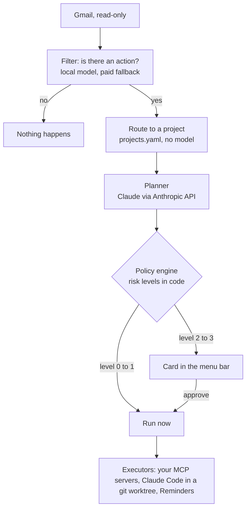

# inbox-orchestrator

A local agent for macOS that sits beside your inbox. It reads each incoming email, works out what work the email asks for, and prepares that work with the tools you already use: your MCP servers, Claude Code, your calendar, your reminders. Things that are safe and reversible happen on their own. Everything else waits for one click in the menu bar.

It is not an email client. You keep reading and writing mail in Gmail. inbox-orchestrator gives you an **action inbox** next to it.

> Status: early alpha (v0.1). Built in the open. Expect rough edges and breaking config changes.

## What it does

A client writes: *"The graph doesn't load when I filter by date, screenshot attached. Can we talk tomorrow at 10?"*

1. A small local model decides the email needs action (a bug report and a meeting request).
2. The sender is matched to a project in your config. No model is involved in that step.
3. A planner model proposes actions for that project: `reproduce_bug`, `prepare_fix`, `schedule_meeting`.
4. A deterministic **policy engine** decides what runs now and what waits:
   - Reproducing the bug and preparing a fix on a branch or checkpoint are local and reversible, so they run immediately.
   - The calendar invite is visible to someone else, so it waits for approval.
5. The menu bar shows one card: *"Bug reproduced, fix ready on a branch. Send Jack an invite for tomorrow 10:00?"* You click **Do it**.

Publishing, deploying, merging, deleting and sending mail always wait for you. No setting changes that.

## How it works



**There are no built-in integrations.** During onboarding the agent reads the MCP servers you already configured for Claude Code and Claude Desktop, checks which ones you actually used recently and in which project folder, and builds a playbook per project: which of *your* tools carries out each generic action. One project might use Base44, another git and Jira, a third Linear and Vercel.

## Requirements

- macOS 13 or later (Linux works for development; Reminders and the background agent need macOS)
- Node.js 22.13 or later (uses Node's built-in SQLite, so nothing compiles on install)
- git
- [Claude Code](https://docs.claude.com/en/docs/claude-code) signed in with your Claude plan. The agent plans with it, so no API key is needed. (An [Anthropic API key](https://console.anthropic.com/) works too.)
- A Google account with Gmail
- Optional: [Ollama](https://ollama.com) to triage email locally for free. Setup installs it with Homebrew if you agree.

## Install

### One line (macOS)

```bash
curl -fsSL https://raw.githubusercontent.com/gunrmic/inbox-orchestrator/main/scripts/install.sh | bash
```

The script checks Node and git, clones the repo to `~/.inbox-orchestrator-app`, builds it, links the `ibo` command, offers to install Claude Code, and then goes straight into `ibo setup`. That is the whole install: one command and a Google sign-in. The agent updates itself daily after that.

### From source

```bash
git clone https://github.com/gunrmic/inbox-orchestrator.git
cd inbox-orchestrator
npm ci             # also builds dist/
npm link           # makes `ibo` available
```

`npm install -g github:gunrmic/inbox-orchestrator` is not recommended: npm builds git dependencies in a temporary folder, which is fragile for packages that compile on install.

### Menu bar app (.dmg, no terminal)

Download the `.dmg` from [Releases](https://github.com/gunrmic/inbox-orchestrator/releases). The daemon and CLI ship inside the app and run on its built-in Node, so you do not need Node, git or a terminal. On first launch a setup window walks you through it, no terminal: sign in with Google, Claude (your Claude Code login is picked up automatically), a one-click local model download with a progress bar, and your projects as cards you check or uncheck, with the email domains for each. After that the app lives in the menu bar, starts at login, and runs the daemon itself.

Notifications come with **Do it** and **Dismiss** buttons for levels 0 to 2, so most cards never need the window. Level 3 and "which project?" questions open it.

Build it yourself:

```bash
npm ci && npm run build
cd menubar && npm ci
npm run dist       # build/dist/Inbox Orchestrator-<version>.dmg
```

Until the app is signed and notarized, the first time you open it, right-click it and choose **Open**. The release workflow signs and notarizes automatically when the Apple secrets are set (see `.github/workflows/release.yml`). You can use everything from the terminal too (`ibo pending`, `ibo approve <id>`).

## Setup

### 1. One command

```bash
ibo setup
```

The installer runs this for you. It skips whatever is already done, so it is safe to re-run. `ibo setup <part>` runs one step: `claude`, `gmail`, `models`, `onboard`, `agent`.

1. **Claude.** If Claude Code is installed and signed in, the agent uses it through `claude -p` (single turn, every tool off), so planning runs on your Claude plan and there is no key to paste. With an API key in the Keychain, the key wins.
2. **Gmail and Calendar, read-only.** One Google sign-in. See below.
3. **Local model.** Installs Ollama with Homebrew if you agree, starts it, and downloads a model sized to your Mac's memory.
4. **Project discovery.** See step 3.
5. **Background agent.** Starts at login.

### 2. Connect Gmail

```bash
ibo setup gmail
```

A browser window opens. Sign in with Google and allow **read-only** access. That's it.

- The scopes are `gmail.readonly` and `calendar.readonly`: the agent cannot send, delete or modify mail, or change your calendar. Calendar is used only during discovery, to see who you meet with.
- The refresh token is stored in your macOS Keychain. Mail is read from your Mac straight to Google's API; no inbox-orchestrator server ever sees it.
- The sign-in uses the project's shared Google OAuth client (a Desktop app client with PKCE). While the app is in Google's verification process, Google shows an "unverified app" screen: click **Advanced > Go to inbox-orchestrator**.

**Bring your own OAuth client (optional).** If your organization requires its own Google Cloud project, create a *Desktop app* OAuth client with the Gmail API enabled and run:

```bash
ibo setup gmail --client-json ~/Downloads/client_secret_XXXX.json
```

or set `IBO_GOOGLE_CLIENT_ID` and `IBO_GOOGLE_CLIENT_SECRET`. Note: a client in Google's *Testing* status issues tokens that expire after 7 days; publish it to *In production* (as an internal or unverified app) to avoid that.

### 3. Discover your projects

```bash
ibo onboard
```

Chats in claude.ai, ChatGPT and Gemini are stored on their servers, not on your Mac, so they are only read if you export them: claude.ai **Settings > Privacy > Export data**, or ChatGPT **Settings > Data controls > Export data**. Onboarding finds the export in `~/Downloads` and asks before using it. Or pass it yourself:

```bash
ibo onboard --import ~/Downloads/data-2026-11-24.zip
```

Only project names, descriptions, chat titles and dates are read. Message contents are not.

The agent collects evidence on your Mac, then asks you short questions with options and a recommendation. Signals that share a name are joined: a folder `coleven-capture`, mail from `coleven.com` and a Claude Project "Coleven" become one project. At the end it asks whether it missed anything: projects in a hosted builder (Base44, for example), on another machine, or that exist only in email can be added by hand.

| Source | What it learns |
| --- | --- |
| `~/.claude.json`, `.mcp.json`, Claude Desktop config | Which MCP servers you have configured |
| `~/.claude/projects` (Claude Code session history) | Which MCP servers you actually used, in which project folder, and when |
| `~/.codex/sessions` (Codex CLI) | Folders you worked in with Codex |
| Cursor, VS Code and Windsurf workspace history | Folders you opened in an editor |
| Gmail headers, sent mail (90 days) | Who you write back to: the strongest sign of a client |
| Google Calendar (90 days) | Domains of people outside your company you meet with |
| Git repos under `~/projects`, `~/apps`, `~/code`, `~/dev`, `~/src`, ... (`IBO_SCAN_ROOTS` to change) | Projects you never opened in any of those tools |
| Newest file change in each folder (ignoring `node_modules`, build output) | Whether work is happening even without commits. Folders found only by an editor or the scan are dropped after 180 days with no changes |
| A Claude or ChatGPT data export, if you pass one with `--import` | Your Claude Projects and recent chat titles, for projects with no code on this Mac |
| Your MCP servers, read-only listing tools only | Apps, boards and repos that exist there |
| Git | Last commit, default branch, remote |
| Gmail, last 90 days, headers only | Which domains and senders write to you, and how often |

From that it proposes projects and marks each one **live** (activity in the last 30 days), **dormant** (30 to 180 days) or **dead** (more than 180 days). Dead projects are left out unless you add them. For every MCP tool a playbook uses, you confirm a risk level.

During discovery the agent only calls read-only listing tools that need no arguments (marked `readOnlyHint`, or named like `list_*`), and never anything whose name suggests a change. Nothing is modified.

Use `ibo onboard --no-model` to propose projects from folders only, without sending evidence to a model.

### 4. Run it

```bash
ibo start           # foreground, logs to the terminal
ibo install-agent   # background, starts at login (launchd), logs in ~/.inbox-orchestrator/logs
ibo doctor          # checks keys, Gmail, Claude Code, Ollama, projects
```

On its first run the agent records where your inbox is and starts from new mail. It never replays old email.

### It keeps learning

- **"Which project is this?"** Mail from a sender that is not mapped to any project gets a card that asks, with the likeliest project first (or a new one). Your answer is saved to `projects.yaml`, and the email is planned again with that project's tools. From the terminal: `ibo assign <id> <project|new>`.
- **Weekly rediscovery.** Every 7 days the agent runs discovery in the background and suggests new projects, projects that went quiet, and ones that came back. They wait in the menu bar (`ibo suggestions` in the terminal). Nothing changes until you accept.
- **Automatic updates.** Installs made with the installer check for a new version daily, build it, check that it starts, and restart. If the new version does not build, it stays on the old one. `ibo update` does it now.
- **Notifications.** Without the menu bar app, the daemon still sends a plain macOS notification when a card is waiting.

Turn any of these off in `settings.yaml` under `maintenance` (`rediscoverDays: 0`, `autoUpdate: false`, `notify: false`).

### Connectors from claude.ai (Base44 and friends)

Connectors you added in claude.ai are not in any config file on your Mac, but Claude Code can use them when it is signed in to the same account. Discovery sees them in your Claude Code history as servers named `claude_ai_<Name>` (for example `claude_ai_Base44`) and can put them in a playbook. The agent then calls that one tool through `claude -p` with only that tool allowed. Risk levels and approvals work exactly like local MCP tools.

To try the pipeline without Gmail:

```bash
ibo simulate --from "Jack <jack@client.com>" --subject "Graph is broken" \
  --body "Filtering by date shows nothing. Can we talk tomorrow at 10?" --dry
```

## Commands

| Command | What it does |
| --- | --- |
| `ibo setup [part]` | Everything in one go: Claude, Gmail, local model, discovery, background agent |
| `ibo onboard` | Discover projects and tools, ask questions, write config |
| `ibo start` | Run the daemon in the foreground |
| `ibo install-agent` / `uninstall-agent` | Run in the background at login |
| `ibo status` | Mode, kill switch, pending count, projects |
| `ibo pending` | List cards waiting for approval |
| `ibo approve <id>` / `reject <id>` | Act on a card |
| `ibo promote <project> <action>` | Make a level-2 action automatic for one project |
| `ibo kill [on\|off]` | Kill switch: nothing executes, everything becomes a card |
| `ibo assign <id> <project\|new>` | Answer "which project is this sender?" for a card |
| `ibo suggestions` | Projects found by the weekly discovery, or that went quiet |
| `ibo update` | Update now (the agent also checks daily) |
| `ibo simulate ...` | Push a fake email through the pipeline |
| `ibo doctor` | Check the installation |

## Risk levels and autonomy

Every action resolves to a risk level. The level comes from code and from `tools.yaml`, never from the model, and never from the email.

| Level | Meaning | Examples | Default | Can be made automatic |
| --- | --- | --- | --- | --- |
| 0 | Read | list, get, search, query | Runs | Always runs |
| 1 | Local and reversible | Claude Code on a new worktree, a checkpoint, a reminder | Runs | Runs |
| 2 | Visible to others | A ticket, a calendar invite, a PR | Card | Yes, per project and action, or globally with `mode: auto` |
| 3 | Dangerous | Publish, deploy, merge, delete, send email, payments | Card | **Never** |

- Tools missing from `tools.yaml` are level 3.
- A tool whose name contains publish, deploy, merge, delete, send, forward, payment and similar words is level 3 even if `tools.yaml` says otherwise.
- After 10 approvals in a row of the same level-2 action in the same project without edits, the agent offers to make it automatic. An edit or a rejection resets the count.
- `mode: auto` in settings makes every level-2 action automatic. Level 3 still waits.

## Models: local first, paid as fallback

| Stage | Default | Why |
| --- | --- | --- |
| Filter (is there an action?) | Local (Ollama) | Most of the volume. A yes/no answer, so a small model is enough, and the mail stays on your Mac |
| Routing | No model | Deterministic match on sender, domain, keywords |
| Planning | Claude (your Claude Code login, or an API key) | A mistake here becomes a wrong action. Small models are weaker at tool choice and at resisting prompt injection |
| Code tasks | Claude Code | Runs on Anthropic models |
| Onboarding | Claude (paid) | Runs once; the quality of the mapping drives everything else |

The local model falls back to the paid model when it is not installed, not running, returns invalid output, or answers with low confidence (`minLocalConfidence`). Every fallback is logged. The reverse never happens: a stage set to the paid model is never silently moved to a local one.

If your organization blocks local models, set `org.allowLocalModels: false` in `settings.yaml` (or `IBO_BLOCK_LOCAL_MODELS=1` from managed configuration) and every stage uses the paid model.

Free cloud tiers are deliberately not supported: some providers' free tiers allow human review of inputs to improve their products, which is not acceptable for client email.

## Configuration

Everything lives in `~/.inbox-orchestrator/` (override with `IBO_HOME`):

| File | Contents |
| --- | --- |
| `settings.yaml` | Mode, kill switch, models, polling. See [examples/settings.yaml](examples/settings.yaml) |
| `projects.yaml` | Projects, email matching, playbooks, autonomy. See [examples/projects.yaml](examples/projects.yaml) |
| `tools.yaml` | Confirmed risk level per MCP tool. See [examples/tools.yaml](examples/tools.yaml) |
| `projects/*.md` | Architecture summary per project, written during onboarding |
| `state.db` | SQLite (Node's built-in `node:sqlite`): processed emails, actions, audit log, approval streaks |
| `api-token` | Token for the local API (mode 0600) |
| `worktrees/` | Git worktrees created for code tasks |

Secrets (Anthropic key, Google refresh token, and your own OAuth client if you set one) are stored in the macOS Keychain under the service name `inbox-orchestrator`.

Config edits apply without a restart: the daemon re-reads the files every polling cycle (or immediately on `kill -HUP`).

## Security model

Every incoming email is untrusted input. Anyone who has your address can try to steer the agent.

- **Content cannot grant authority.** Email text reaches the models wrapped as labelled data. Risk levels are decided in code after the model has proposed a plan. An email that says "deploy to production" changes nothing.
- **Unknown senders get nothing.** Mail from a sender that is not mapped to a project never reaches the planner or any project tool. At most it becomes a reminder suggestion.
- **Spoofing check.** Mail that passes neither SPF nor DKIM (including mail with no authentication results) can never trigger code execution, and its other actions become cards.
- **Code runs isolated.** Claude Code works in a new git worktree on a new branch, with an allow-list of tools: no network tools, no `git push`, no `git remote`. Changes are committed locally only. Pushing or opening a PR can only happen through a separate action mapped to one of your MCP tools, at level 2 or higher.
- **Read-only Google access.** The OAuth scopes are `gmail.readonly` and `calendar.readonly`.
- **Planning through Claude Code runs with every tool off** (`--max-turns 1`, no built-in tools, no MCP servers), so an email cannot make it do anything but answer.
- **Local API.** Bound to 127.0.0.1 and protected by a random token.
- **Audit log.** Every filter result, plan, decision, approval, execution, fallback and kill-switch change is recorded in `state.db`.
- **Kill switch.** `ibo kill` or the checkbox in the menu bar turns every action into a card.
- **Privacy.** Email content goes only to the model providers you configured. With a local filter model, mail that needs no action never leaves your Mac.

## Project layout

```
src/
  cli.ts                 ibo command
  daemon.ts              polling loop + local API
  runtime.ts             wiring
  config/                zod schemas, YAML loading, paths
  gmail/                 OAuth (read-only), history polling, MIME parsing
  pipeline/              filter, router, planner, orchestration, prompts
  policy/                risk levels and the decision engine
  models/                Anthropic + Ollama providers, router with fallback
  executors/             MCP hub, Claude Code worktree runner, Reminders
  discovery/             MCP configs, Claude Code sessions, activity, probes, onboarding
  server/                local HTTP API for the menu bar
  store/                 SQLite state and audit log
menubar/                 Electron menu bar app
examples/                example config files
scripts/install.sh       macOS installer
test/                    unit, integration, e2e (Vitest)
menubar/e2e/             menu bar e2e (Playwright)
```

## Development

```bash
npm ci                     # installs, builds, and enables the git hooks
npm run dev -- --help      # run the CLI from source with tsx
IBO_HOME=/tmp/ibo npm run dev -- simulate --from a@b.com --subject x --body y --dry
```

## Testing

Four layers, all with throwaway state folders and the file secrets backend, so no test touches your real config, Keychain, Gmail or Anthropic account.

| Suite | Command | What it covers | Tools |
| --- | --- | --- | --- |
| Unit | `npm run test:unit` | Policy engine, risk levels, routing, model fallback, prompts, config, secrets, Gmail parsing and polling, discovery, executors, launchd | Vitest |
| Integration | `npm run test:integration` | A real MCP server over stdio, Claude Code on a real git repo (with a fake `claude`), the HTTP API, the daemon cycle, onboarding with scripted answers | Vitest |
| End to end | `npm run test:e2e` | The built `ibo` CLI and daemon as real processes against fake Anthropic and Ollama servers: setup, onboarding, simulate, approve, reject, kill switch, promotion | Vitest + child processes |
| Installer | `npm run test:install` | Runs `scripts/install.sh` for real from a snapshot of the working tree, then the installed `ibo` | Vitest + bash |
| Menu bar | `npm run test:menubar` | Drives the Electron app against a live daemon: renders cards, edits and approves, kill switch | Playwright |

```bash
npm test                  # unit + integration + e2e
npm run test:coverage     # unit + integration with coverage thresholds (85% lines)
npm run test:all          # everything, including installer and menu bar
```

On Linux the menu bar tests need a virtual display: `cd menubar && xvfb-run -a npx playwright test`.

### Git hooks and CI

- **pre-commit** (Husky): typecheck, build, unit, integration and e2e tests.
- **pre-push**: everything, including coverage thresholds, the real installer and the menu bar app.
- **GitHub Actions**: every push and pull request runs the full suite on macOS and Linux, plus Node 22, 24 and 26.

Use `git commit --no-verify` only in an emergency; CI runs the same checks anyway.

## Roadmap

- [ ] Gmail push notifications (Pub/Sub) instead of polling
- [ ] Apple Developer signing for the `.dmg`, Homebrew cask
- [ ] Outlook / Microsoft 365 source
- [ ] Run code tasks in a container in addition to a worktree
- [ ] Per-project activity thresholds
- [ ] Undo for level-1 actions from the menu bar

## Known limitations

- Connectors that exist only in claude.ai are reached through Claude Code. A connector you never used in Claude Code does not appear in discovery; add it by hand at the end of onboarding.
- When the Mac sleeps, nothing runs. On wake, history sync picks up what arrived.
- The model names in the default settings are configurable. If a default is not available on your account or in Ollama, change it in `settings.yaml`.

## License

MIT, see [LICENSE](LICENSE).

Built by [Omer Michaeli](https://omermichaeli.dev).
