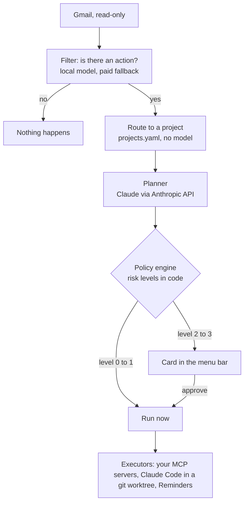

# inbox-orchestrator

A local agent for macOS that sits beside your inbox. It reads each incoming email, works out what work the email asks for, and prepares that work with the tools you already use: your MCP servers, Claude Code, your calendar, your reminders. Things that are safe and reversible happen on their own. Everything else waits for one click in the menu bar.

It is not an email client. You keep reading and writing mail in Gmail. inbox-orchestrator gives you an **action inbox** next to it.

> Status: early alpha (v0.1). Built in the open. Expect rough edges and breaking config changes.

## What it does

A client writes: *"The graph doesn't load when I filter by date, screenshot attached. Can we talk tomorrow at 10?"*

1. A small local model decides the email needs action (a bug report and a meeting request).
2. The sender is matched to a project in your config. No model is involved in that step.
3. A planner model proposes actions for that project: `reproduce_bug`, `prepare_fix`, `schedule_meeting`.
4. A deterministic **policy engine** decides what runs now and what waits:
   - Reproducing the bug and preparing a fix on a branch or checkpoint are local and reversible, so they run immediately.
   - The calendar invite is visible to someone else, so it waits for approval.
5. The menu bar shows one card: *"Bug reproduced, fix ready on a branch. Send Jack an invite for tomorrow 10:00?"* You click **Do it**.

Publishing, deploying, merging, deleting and sending mail always wait for you. No setting changes that.

## How it works



**There are no built-in integrations.** During onboarding the agent reads the MCP servers you already configured for Claude Code and Claude Desktop, checks which ones you actually used recently and in which project folder, and builds a playbook per project: which of *your* tools carries out each generic action. One project might use Base44, another git and Jira, a third Linear and Vercel.

## Requirements

- macOS 13 or later (Linux works for development; Reminders and the background agent need macOS)
- Node.js 20 or later
- git
- An [Anthropic API key](https://console.anthropic.com/) for planning
- A Google account with Gmail
- Optional: [Claude Code](https://docs.claude.com/en/docs/claude-code) for code tasks in git projects
- Optional: [Ollama](https://ollama.com) to run email triage locally for free

## Install

### One line (macOS)

```bash
curl -fsSL https://raw.githubusercontent.com/gunrmic/inbox-orchestrator/main/scripts/install.sh | bash
```

The script checks Node and git, clones the repo to `~/.inbox-orchestrator-app`, builds it, links the `ibo` command, and offers to install Claude Code. Run it again any time to update.

### From source

```bash
git clone https://github.com/gunrmic/inbox-orchestrator.git
cd inbox-orchestrator
npm ci             # also builds dist/
npm link           # makes `ibo` available
```

`npm install -g github:gunrmic/inbox-orchestrator` is not recommended: npm builds git dependencies in a temporary folder, which is fragile for packages that compile on install.

### Menu bar app

The menu bar app is a small Electron app that talks to the local daemon.

```bash
cd menubar
npm install
npm start          # run it
npm run dist       # build a .dmg in menubar/dist
```

The `.dmg` is not signed or notarized yet, so the first time you open it, right-click the app and choose **Open**. You can use everything from the terminal too (`ibo pending`, `ibo approve <id>`).

## Setup

### 1. Connect everything

```bash
ibo setup
```

This asks for three things and is safe to re-run (`ibo setup anthropic`, `ibo setup gmail`, `ibo setup models` do one part):

- **Anthropic API key.** Stored in the macOS Keychain, never in a config file.
- **Gmail, read-only.** See below.
- **Local model.** If Ollama is running, the agent suggests a model size based on your Mac's memory.

### 2. Connect Gmail

inbox-orchestrator uses your own Google OAuth client, so no third party ever holds a token to your mail. The scope is `gmail.readonly`: the agent cannot send, delete or modify mail.

1. Open [Google Cloud Console](https://console.cloud.google.com/), create a project (any name).
2. **APIs & Services > Library**: enable the **Gmail API**.
3. **APIs & Services > OAuth consent screen**: choose *External*, fill in the app name and your email, and add yourself under **Test users**.
4. **APIs & Services > Credentials > Create credentials > OAuth client ID**: application type **Desktop app**. Download the JSON.
5. Run `ibo setup gmail`, give it the path to the JSON, and sign in in the browser that opens.

### 3. Discover your projects

```bash
ibo onboard
```

The agent collects evidence on your Mac, then asks you short questions with options and a recommendation:

| Source | What it learns |
| --- | --- |
| `~/.claude.json`, `.mcp.json`, Claude Desktop config | Which MCP servers you have configured |
| `~/.claude/projects` (Claude Code session history) | Which MCP servers you actually used, in which project folder, and when |
| Your MCP servers, read-only listing tools only | Apps, boards and repos that exist there |
| Git | Last commit, default branch, remote |
| Gmail, last 90 days, headers only | Which domains and senders write to you, and how often |

From that it proposes projects and marks each one **live** (activity in the last 30 days), **dormant** (30 to 180 days) or **dead** (more than 180 days). Dead projects are left out unless you add them. For every MCP tool a playbook uses, you confirm a risk level.

During discovery the agent only calls read-only listing tools that need no arguments (marked `readOnlyHint`, or named like `list_*`), and never anything whose name suggests a change. Nothing is modified.

Use `ibo onboard --no-model` to propose projects from folders only, without sending evidence to a model.

### 4. Run it

```bash
ibo start           # foreground, logs to the terminal
ibo install-agent   # background, starts at login (launchd), logs in ~/.inbox-orchestrator/logs
ibo doctor          # checks keys, Gmail, Claude Code, Ollama, projects
```

On its first run the agent records where your inbox is and starts from new mail. It never replays old email.

To try the pipeline without Gmail:

```bash
ibo simulate --from "Jack <jack@client.com>" --subject "Graph is broken" \
  --body "Filtering by date shows nothing. Can we talk tomorrow at 10?" --dry
```

## Commands

| Command | What it does |
| --- | --- |
| `ibo setup [part]` | Connect Anthropic, Gmail and a local model |
| `ibo onboard` | Discover projects and tools, ask questions, write config |
| `ibo start` | Run the daemon in the foreground |
| `ibo install-agent` / `uninstall-agent` | Run in the background at login |
| `ibo status` | Mode, kill switch, pending count, projects |
| `ibo pending` | List cards waiting for approval |
| `ibo approve <id>` / `reject <id>` | Act on a card |
| `ibo promote <project> <action>` | Make a level-2 action automatic for one project |
| `ibo kill [on\|off]` | Kill switch: nothing executes, everything becomes a card |
| `ibo simulate ...` | Push a fake email through the pipeline |
| `ibo doctor` | Check the installation |

## Risk levels and autonomy

Every action resolves to a risk level. The level comes from code and from `tools.yaml`, never from the model, and never from the email.

| Level | Meaning | Examples | Default | Can be made automatic |
| --- | --- | --- | --- | --- |
| 0 | Read | list, get, search, query | Runs | Always runs |
| 1 | Local and reversible | Claude Code on a new worktree, a checkpoint, a reminder | Runs | Runs |
| 2 | Visible to others | A ticket, a calendar invite, a PR | Card | Yes, per project and action, or globally with `mode: auto` |
| 3 | Dangerous | Publish, deploy, merge, delete, send email, payments | Card | **Never** |

- Tools missing from `tools.yaml` are level 3.
- A tool whose name contains publish, deploy, merge, delete, send, forward, payment and similar words is level 3 even if `tools.yaml` says otherwise.
- After 10 approvals in a row of the same level-2 action in the same project without edits, the agent offers to make it automatic. An edit or a rejection resets the count.
- `mode: auto` in settings makes every level-2 action automatic. Level 3 still waits.

## Models: local first, paid as fallback

| Stage | Default | Why |
| --- | --- | --- |
| Filter (is there an action?) | Local (Ollama) | Most of the volume. A yes/no answer, so a small model is enough, and the mail stays on your Mac |
| Routing | No model | Deterministic match on sender, domain, keywords |
| Planning | Claude (paid) | A mistake here becomes a wrong action. Small models are weaker at tool choice and at resisting prompt injection |
| Code tasks | Claude Code | Runs on Anthropic models |
| Onboarding | Claude (paid) | Runs once; the quality of the mapping drives everything else |

The local model falls back to the paid model when it is not installed, not running, returns invalid output, or answers with low confidence (`minLocalConfidence`). Every fallback is logged. The reverse never happens: a stage set to the paid model is never silently moved to a local one.

If your organization blocks local models, set `org.allowLocalModels: false` in `settings.yaml` (or `IBO_BLOCK_LOCAL_MODELS=1` from managed configuration) and every stage uses the paid model.

Free cloud tiers are deliberately not supported: some providers' free tiers allow human review of inputs to improve their products, which is not acceptable for client email.

## Configuration

Everything lives in `~/.inbox-orchestrator/` (override with `IBO_HOME`):

| File | Contents |
| --- | --- |
| `settings.yaml` | Mode, kill switch, models, polling. See [examples/settings.yaml](examples/settings.yaml) |
| `projects.yaml` | Projects, email matching, playbooks, autonomy. See [examples/projects.yaml](examples/projects.yaml) |
| `tools.yaml` | Confirmed risk level per MCP tool. See [examples/tools.yaml](examples/tools.yaml) |
| `projects/*.md` | Architecture summary per project, written during onboarding |
| `state.db` | SQLite: processed emails, actions, audit log, approval streaks |
| `api-token` | Token for the local API (mode 0600) |
| `worktrees/` | Git worktrees created for code tasks |

Secrets (Anthropic key, Google OAuth client and refresh token) are stored in the macOS Keychain under the service name `inbox-orchestrator`.

Config edits apply without a restart: the daemon re-reads the files every polling cycle (or immediately on `kill -HUP`).

## Security model

Every incoming email is untrusted input. Anyone who has your address can try to steer the agent.

- **Content cannot grant authority.** Email text reaches the models wrapped as labelled data. Risk levels are decided in code after the model has proposed a plan. An email that says "deploy to production" changes nothing.
- **Unknown senders get nothing.** Mail from a sender that is not mapped to a project never reaches the planner or any project tool. At most it becomes a reminder suggestion.
- **Spoofing check.** Mail that passes neither SPF nor DKIM (including mail with no authentication results) can never trigger code execution, and its other actions become cards.
- **Code runs isolated.** Claude Code works in a new git worktree on a new branch, with an allow-list of tools: no network tools, no `git push`, no `git remote`. Changes are committed locally only. Pushing or opening a PR can only happen through a separate action mapped to one of your MCP tools, at level 2 or higher.
- **Read-only Gmail.** The OAuth scope is `gmail.readonly`.
- **Local API.** Bound to 127.0.0.1 and protected by a random token.
- **Audit log.** Every filter result, plan, decision, approval, execution, fallback and kill-switch change is recorded in `state.db`.
- **Kill switch.** `ibo kill` or the checkbox in the menu bar turns every action into a card.
- **Privacy.** Email content goes only to the model providers you configured. With a local filter model, mail that needs no action never leaves your Mac.

## Project layout

```
src/
  cli.ts                 ibo command
  daemon.ts              polling loop + local API
  runtime.ts             wiring
  config/                zod schemas, YAML loading, paths
  gmail/                 OAuth (read-only), history polling, MIME parsing
  pipeline/              filter, router, planner, orchestration, prompts
  policy/                risk levels and the decision engine
  models/                Anthropic + Ollama providers, router with fallback
  executors/             MCP hub, Claude Code worktree runner, Reminders
  discovery/             MCP configs, Claude Code sessions, activity, probes, onboarding
  server/                local HTTP API for the menu bar
  store/                 SQLite state and audit log
menubar/                 Electron menu bar app
examples/                example config files
scripts/install.sh       macOS installer
test/                    vitest suite
```

## Development

```bash
npm install
npm run typecheck
npm test
npm run dev -- --help      # run the CLI from source with tsx
IBO_HOME=/tmp/ibo npm run dev -- simulate --from a@b.com --subject x --body y --dry
```

The tests cover the policy engine, risk classification, routing, model fallback, discovery parsers, Gmail parsing and the full pipeline with fake models.

## Roadmap

- [ ] Gmail push notifications (Pub/Sub) instead of polling
- [ ] Signed and notarized `.dmg`, Homebrew cask
- [ ] Outlook / Microsoft 365 source
- [ ] Run code tasks in a container in addition to a worktree
- [ ] Per-project activity thresholds
- [ ] Undo for level-1 actions from the menu bar
- [ ] Re-run discovery in the background when mail arrives from an unmapped domain

## Known limitations

- Connectors that exist only in claude.ai are not visible from the Mac. Add them as local MCP servers to use them here.
- When the Mac sleeps, nothing runs. On wake, history sync picks up what arrived.
- The model names in the default settings are configurable. If a default is not available on your account or in Ollama, change it in `settings.yaml`.

## License

MIT, see [LICENSE](LICENSE).

Built by [Omer Michaeli](https://omermichaeli.dev).
